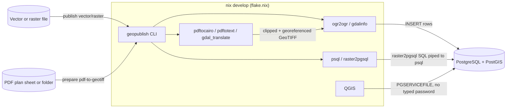

# Specification: geopublish

## Purpose

A reproducible, Nix-provisioned workflow that publishes vector and raster
geospatial files to a PostgreSQL/PostGIS database, and makes the results
viewable in QGIS without typing credentials into QGIS itself.

## User stories

1. **As a workshop participant**, I want to run one command to load a
   shapefile/GeoPackage/GeoJSON into PostGIS, so I don't need to hand-write
   `ogr2ogr` invocations.
2. **As a workshop participant**, I want to run one command to load a
   GeoTIFF into PostGIS as a raster table, so I don't need to remember
   `raster2pgsql` flags.
3. **As a workshop participant**, I want to confirm what's been published
   (and that my DB connection works) without opening a SQL client.
4. **As a workshop participant**, I want to open QGIS and immediately see my
   published layers, without copying a password into the QGIS connection
   dialog.
5. **As a facilitator**, I want every dependency (Python, GDAL, PostGIS
   client tools, QGIS, docs tooling, linters) provisioned identically on
   every participant's machine via one `nix develop`, so "it works on my
   machine" isn't a workshop failure mode.
6. **As a workshop participant**, I want to drop a folder of PDF plan
   sheets (e.g. utility "Netzauskunft" exports with printed corner
   coordinates) and get back georeferenced GeoTIFFs, without manually
   picking ground control points for each one.

## Out of scope (v0.1)

- Running a local PostgreSQL/PostGIS server (the workshop connects to an
  existing external server; connection details live in a gitignored `.env`).
- Auto-generating a full QGIS `.qgs` project file — QGIS's native
  `PGSERVICEFILE` + Browser-panel connection is simpler and more robust than
  hand-authoring QGIS's project XML.
- Point cloud (COPC) and Cloud-Optimized GeoTIFF (COG)-specific tooling;
  those live in the sibling workshop module folders (`3_COG_1`, `4_COPC_1`)
  and are out of this tool's scope unless folded in later.

## Architecture

## Functional requirements

| ID | Requirement |
|---|---|
| FR1 | `geopublish init-db` creates the `postgis` and `postgis_raster` extensions if not already present. |
| FR2 | `geopublish publish vector <file> --table <name>` loads any OGR-readable vector file into the given table, defaulting to overwrite, with `--append` to append instead, and `--srid` to reproject. |
| FR3 | `geopublish publish raster <file> --table <name>` loads any GDAL-readable raster into the given table via `raster2pgsql \| psql`, with the same `--append`/`--srid` semantics plus `--tile-size`. |
| FR4 | `geopublish status` confirms the DB connection and lists every published vector (`geometry_columns`) and raster (`raster_columns`) table. |
| FR5 | All connection details are read from environment variables (`PGHOST`, `PGPORT`, `PGDATABASE`, `PGUSER`, `PGPASSWORD`, `PGSSLMODE`), loaded from a gitignored `.env`; missing required variables fail fast with a clear message. |
| FR6 | A `pg_service.conf` template lets QGIS and `psql` connect via `PGSERVICEFILE` without re-entering credentials. |
| FR7 | `geopublish docs-serve` (alias `gp docs-serve`) serves the mkdocs site locally, including this specification. |
| FR8 | `geopublish prepare pdf-to-geotiff <pdf-or-folder> --output-dir <dir>` rasterizes each page of each PDF, clips it to its drawn map frame, and georeferences it to a GeoTIFF. The frame (PDF-point bbox) is detected from the largest non-full-page `fill="none"` rectangle in the page's SVG export; the real-world bbox is detected from printed zone-prefixed-easting/northing text labels (German decimal-comma format). `--utm-zone`/`--srs` override the default (zone 32, EPSG:25832). A sheet missing its coordinate labels is reported as failed without aborting the rest of a batch. |

## Non-functional requirements

- **Reproducibility**: every tool the CLI shells out to (`ogr2ogr`, `psql`,
  `raster2pgsql`, `qgis`) is provisioned by the flake; nothing is assumed to
  pre-exist on the host.
- **No PyPI/npm dependency**: all Python packages come from nixpkgs.
- **Security**: no secret is ever passed on the command line or committed;
  `.env` and `pg_service.conf` are gitignored; `gitleaks` runs pre-commit.

## Testing

- `tests/test_config.py` — environment-variable loading and validation,
  without a live database.
- `tests/test_cli.py` — CLI surface (`--help` on every command, failure
  path when configuration is missing), using Click's `CliRunner`, without a
  live database.
- Integration testing against a real PostGIS instance is a manual workshop
  step (run `geopublish init-db` / `publish` / `status` against your
  configured `.env`), not part of the automated suite in v0.1.
- `tests/test_pdfmap.py` — frame/coordinate-label detection and the
  points-to-pixels conversion, against fixtures trimmed from a real plan
  sheet's SVG/bbox export, without needing a live `pdftocairo`/`gdal_translate`
  call per test run.

## Documentation

- `README.md` — quickstart and QGIS connection steps.
- `PACKAGES.md` — annotated dependency list.
- `docs/` (mkdocs) — user, admin, and developer guides, plus this
  specification, published via `nix run .#docs` or `gp docs-serve`. The
  specification page is generated from this file by `scripts/docs.sh`
  (copied to `docs/specification.md`, which is gitignored) so there is a
  single source of truth.
- This file, updated whenever functional requirements change.
