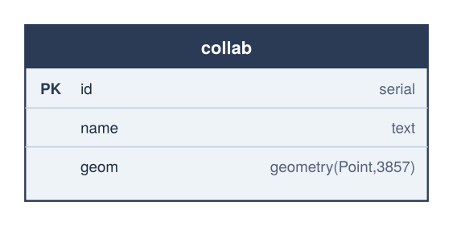
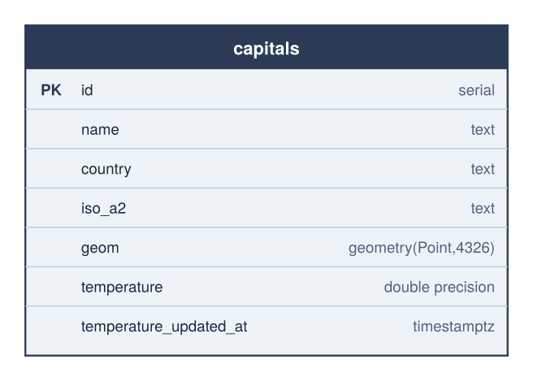
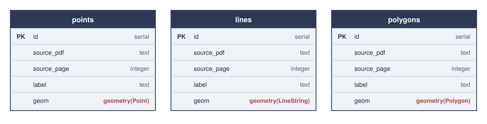

# Specification: geopublish

## Purpose

A reproducible, Nix-provisioned workflow that publishes vector and raster
geospatial files to a PostgreSQL/PostGIS database, and makes the results
viewable in QGIS without typing credentials into QGIS itself.

## User stories

1. **As a workshop participant**, I want to run one command to load a
   shapefile/GeoPackage/GeoJSON into PostGIS, so I don't need to hand-write
   `ogr2ogr` invocations.
2. **As a workshop participant**, I want to run one command to load a
   GeoTIFF into PostGIS as a raster table, so I don't need to remember
   `raster2pgsql` flags.
3. **As a workshop participant**, I want to confirm what's been published
   (and that my DB connection works) without opening a SQL client.
4. **As a workshop participant**, I want to open QGIS and immediately see my
   published layers, without copying a password into the QGIS connection
   dialog.
5. **As a facilitator**, I want every dependency (Python, GDAL, PostGIS
   client tools, QGIS, docs tooling, linters) provisioned identically on
   every participant's machine via one `nix develop`, so "it works on my
   machine" isn't a workshop failure mode.
6. **As a workshop participant**, I want to drop a folder of PDF plan
   sheets (e.g. utility "Netzauskunft" exports with printed corner
   coordinates) and get back georeferenced GeoTIFFs, without manually
   picking ground control points for each one.
7. **As a workshop participant**, I want a world capitals layer with a
   live temperature attribute, refreshable with one command, without
   signing up for a weather API key.
8. **As a workshop participant**, I want a PDF plan sheet's actual vector
   geometry (not a raster of it) in PostGIS as proper points/lines/
   polygons, with whatever printed annotation is nearby attached as an
   attribute, since vector features are lighter to query than a raster
   scan of the same drawing.
9. **As Tim**, I want a record of every prompt that built this project
   and the requirement each one introduced, exportable as a PDF, so the
   session's decisions are traceable after the fact.

## Out of scope (v0.1)

- Running a local PostgreSQL/PostGIS server (the workshop connects to an
  existing external server; connection details live in a gitignored `.env`).
- Auto-generating a full QGIS `.qgs` project file — QGIS's native
  `PGSERVICEFILE` + Browser-panel connection is simpler and more robust than
  hand-authoring QGIS's project XML.
- Point cloud (COPC) and Cloud-Optimized GeoTIFF (COG)-specific tooling;
  those live in the sibling workshop module folders (`3_COG_1`, `4_COPC_1`)
  and are out of this tool's scope unless folded in later.

## Architecture

Two things this diagram is making a point of, that prose would bury: a PDF
plan sheet doesn't get its own publish path — `pdf-to-geotiff`'s output is
an ordinary GeoTIFF that loops back into `gp publish raster`, so there is
only one way data reaches Postgres from a file. QGIS is the one component
that never calls `gp` at all; it talks to Postgres directly over
`PGSERVICEFILE`.

Diagram source: `docs/diagrams/architecture.svg`, rendered via
`nix run .#diagrams` (wraps Inkscape, provisioned by the flake — see
"Diagrams" below).

## Data model

### `collab`

A shared "drop a pin with your name" table (`sql/create_collab_table.sql`),
EPSG:3857.

| Column | Type | Constraints | Description |
|---|---|---|---|
| `id` | `serial` | `PRIMARY KEY` | Surrogate key, assigned on insert. |
| `name` | `text` | — | Contributor's name, entered via the QGIS form. |
| `geom` | `geometry(Point, 3857)` | — | Dropped-pin location, Web Mercator. |

`SELECT, INSERT, UPDATE, DELETE` are granted to `PUBLIC` (and `USAGE,
SELECT` on its `id` sequence), so every connected role can add, move, and
delete pins — not just the role that created the table.

A statement-level `AFTER INSERT OR UPDATE OR DELETE OR TRUNCATE` trigger
(`collab_change_notify`) calls `pg_notify('qgis', 'collab')` on every CRUD
event. The channel is `qgis` because QGIS's PostgreSQL provider hardcodes
`LISTEN qgis` — it is not configurable — so every notify-enabled table in
this project shares that one channel and is told apart by payload
(`'collab'` here, matching `setRefreshOnNotifyMessage()` on the layer).
`sql/drop_collab_notify.sql` reverts just this trigger/function, leaving
the table and its data untouched.

Shared via `qgis/layers/collab.qlr` — a QGIS Layer Definition carrying the
point styling, edit-form configuration, and the refresh-on-notify wiring
above (see the [user guide](docs/user/index.md#collaboration-layer)), so
participants get the same look, form, and live updates without
rebuilding it themselves.

Diagram source: `docs/diagrams/collab-table.svg`.

### `collab_buffer_100km` (view)

A live, dissolved 100km buffer around every `collab` pin
(`sql/create_collab_buffer_view.sql`). Not materialized — it recomputes
on every query, so there is nothing to keep in sync.

| Column | Type | Description |
|---|---|---|
| `id` | `integer` | Constant `1`; gives the single output row a key, since views have no primary key of their own. |
| `geom` | `geometry(MultiPolygon, 3857)` | `ST_Union` of a 100km `geography` buffer (geodesically correct, unlike buffering in 3857 directly) around every row in `collab`, transformed back to 3857. |

Views can't carry their own trigger on the underlying table's changes, so
`collab`'s `notify_collab_change()` trigger (above) is extended to also
emit `pg_notify('qgis', 'collab_buffer')` — a second, independent payload
on the same channel, for a layer built on this view to opt into via
`qgis/layers/collab_buffer_100km.qlr`. `sql/drop_collab_buffer_view.sql`
drops the view and reverts the trigger to the single-payload version.

### `capitals`

World national capitals (`geopublish capitals load`), with a live
temperature kept current by `geopublish capitals refresh-weather`. Both
data sources are free and require no API key — see
[PACKAGES.md](PACKAGES.md#external-data-sources).

| Column | Type | Description |
|---|---|---|
| `id` | `serial` | Primary key, assigned by `ogr2ogr` on load. |
| `name` | `text` | City name (Natural Earth `name`). |
| `country` | `text` | Country name (Natural Earth `adm0name`). |
| `iso_a2` | `text` | Two-letter country code. |
| `geom` | `geometry(Point, 4326)` | Native Natural Earth CRS (WGS84 lon/lat) — left untransformed since `refresh-weather` reads it straight back out as lat/lon for Open-Meteo. |
| `temperature` | `double precision` | Current temperature in °C, from Open-Meteo. `NULL` until the first `refresh-weather` run. |
| `temperature_updated_at` | `timestamptz` | When `temperature` was last fetched. |

`capitals load` is the reference-dataset step (`ogr2ogr -overwrite` —
re-running it replaces the table and loses any fetched temperatures, so
it's meant to run once). `capitals refresh-weather` is the repeatable
step: it fetches every row's current temperature sequentially (~200
cities, well under Open-Meteo's free-tier limits) and `UPDATE`s it in
place; a single city's fetch failing doesn't stop the rest.

Diagram source: `docs/diagrams/capitals-table.svg`.

### `points` / `lines` / `polygons`

Vector geometry extracted directly from a PDF plan sheet's drawing
commands (`geopublish publish pdf-vectors`), as an alternative to
publishing it as a raster. Shared across every PDF processed — rows
accumulate rather than being replaced, with `source_pdf`/`source_page`
identifying where each one came from.

All three share the same shape, differing only in `geom`'s geometry type:

| Column | Type | Description |
|---|---|---|
| `id` | `serial` | Primary key, assigned on insert. |
| `source_pdf` | `text` | File name the row came from. |
| `source_page` | `integer` | Page number within that PDF. |
| `label` | `text` | Nearest printed text label, best-effort (see below). `NULL` if nothing was close enough. |
| `geom` | `geometry(Point\|LineString\|Polygon, <srid>)` | `--srid` (default `25832`), using the same frame/corner-coordinate detection as `prepare pdf-to-geotiff`. |

**Classification** is by how each path is drawn, not by guessing intent:
a filled shape is a `polygon` (e.g. a building); an unfilled stroked path
is a `line` (e.g. a parcel boundary or road); a path whose bounding box
is very small (a vertex marker, under 10pt diagonal) is a `point`,
regardless of fill. This project does not attempt to reconstruct closed
parcel polygons from a network of shared boundary *lines* — real-world
cadastral exports draw boundaries as a planar graph of edges, not one
closed ring per parcel, and dissolving that network into faces is a
separate, harder problem than this command takes on.

**Not every PDF has extractable vector content to begin with.** Some
exports (confirmed on the Netze BW "Netzauskunft" sample in `PLANS/`)
bake the entire cadastral drawing in as an embedded raster image, with
only the frame border and text labels as real vector content — it can
*look* like crisp vector line art once rendered, but there's no path
data behind it to extract. If a page yields zero features and the SVG
export contains an embedded `<image>`, `extract_vector_features` raises
rather than silently reporting `0, 0, 0`; `prepare pdf-to-geotiff` +
`publish raster` is the only viable path for that page.

**Label matching** is nearest-text-line-to-bbox-centre, within a
kind-specific radius (12pt for points, 80pt for lines/polygons — tight
for points so a distant parcel number doesn't get misattributed to every
vertex marker along a boundary). `pdftotext -bbox` reports individual
words with no line grouping, so words are first merged into lines by
proximity (same baseline, small horizontal gap) before matching. This is
a heuristic, not a layout parser — a feature with no sufficiently close
text gets `label = NULL` rather than a wrong guess.

Diagram source: `docs/diagrams/pdf-vector-tables.svg`.

## Functional requirements

| ID | Requirement |
|---|---|
| FR1 | `geopublish init-db` creates the `postgis` and `postgis_raster` extensions if not already present. |
| FR2 | `geopublish publish vector <file> --table <name>` loads any OGR-readable vector file into the given table, defaulting to overwrite, with `--append` to append instead, and `--srid` to reproject. |
| FR3 | `geopublish publish raster <file> --table <name>` loads any GDAL-readable raster into the given table via `raster2pgsql \| psql`, with the same `--append`/`--srid` semantics plus `--tile-size`. |
| FR4 | `geopublish status` confirms the DB connection and lists every published vector (`geometry_columns`) and raster (`raster_columns`) table. |
| FR5 | All connection details are read from environment variables (`PGHOST`, `PGPORT`, `PGDATABASE`, `PGUSER`, `PGPASSWORD`, `PGSSLMODE`), loaded from a gitignored `.env`; missing required variables fail fast with a clear message. |
| FR6 | A `pg_service.conf` template lets QGIS and `psql` connect via `PGSERVICEFILE` without re-entering credentials. |
| FR7 | `geopublish docs-serve` (alias `gp docs-serve`) serves the mkdocs site locally, including this specification. |
| FR8 | `geopublish prepare pdf-to-geotiff <pdf-or-folder> --output-dir <dir>` rasterizes each page of each PDF, clips it to its drawn map frame, and georeferences it to a GeoTIFF. The frame (PDF-point bbox) is detected from the largest non-full-page `fill="none"` rectangle in the page's SVG export; the real-world bbox is detected from printed zone-prefixed-easting/northing text labels (German decimal-comma format). `--utm-zone`/`--srs` override the default (zone 32, EPSG:25832). A sheet missing its coordinate labels is reported as failed without aborting the rest of a batch. |
| FR9 | `geopublish capitals load` loads the world's national capitals (Natural Earth, public domain, no API key) into a `capitals` table. `geopublish capitals refresh-weather` fetches each row's current temperature from Open-Meteo (free, no API key) and updates `temperature`/`temperature_updated_at` in place; one city's fetch failing doesn't stop the rest. |
| FR10 | `geopublish publish pdf-vectors <pdf-or-folder>` extracts point/line/polygon geometry directly from a PDF's drawing commands (classified by fill: filled → polygon, unfilled-stroked → line, very small → point) and loads it into shared `points`/`lines`/`polygons` tables, with `--srid`/`--utm-zone` matching `prepare pdf-to-geotiff`. The nearest printed text label (words merged into lines by proximity, then matched within a kind-specific radius) is attached as `label`; a feature with no close-enough text gets `label = NULL`. One bad page doesn't abort the rest of a batch. |
| FR11 | `docs/transcript.md` records every prompt from this project's build session with the requirement/fix it introduced, alongside `docs/diagrams/requirements-timeline.svg` tracing the distinct ones. `geopublish docs-pdf` renders the transcript page to `transcript.pdf` (pandoc → HTML → weasyprint). `geopublish docs-build` produces the static mkdocs site for CI/Pages publishing. |

## Non-functional requirements

- **Reproducibility**: every tool the CLI shells out to (`ogr2ogr`, `psql`,
  `raster2pgsql`, `qgis`) is provisioned by the flake; nothing is assumed to
  pre-exist on the host.
- **No PyPI/npm dependency**: all Python packages come from nixpkgs.
- **Security**: no secret is ever passed on the command line or committed;
  `.env` and `pg_service.conf` are gitignored; `gitleaks` runs pre-commit.

## Testing

- `tests/test_config.py` — environment-variable loading and validation,
  without a live database.
- `tests/test_cli.py` — CLI surface (`--help` on every command, failure
  path when configuration is missing), using Click's `CliRunner`, without a
  live database.
- Integration testing against a real PostGIS instance is a manual workshop
  step (run `geopublish init-db` / `publish` / `status` against your
  configured `.env`), not part of the automated suite in v0.1.
- `tests/test_pdfmap.py` — frame/coordinate-label detection and the
  points-to-pixels conversion, against fixtures trimmed from a real plan
  sheet's SVG/bbox export, without needing a live `pdftocairo`/`gdal_translate`
  call per test run.
- `tests/test_pdfvectors.py` — path classification (point/line/polygon),
  label-line merging and nearest-label matching, and the DB-loading
  insert/skip logic, against synthetic SVG/bbox fixtures plus a mocked
  connection -- no live `pdftocairo`/database call per test run. Also
  `tests/test_capitals.py` for `parse_temperature` (against a real
  captured Open-Meteo response) and `refresh_weather`'s per-city failure
  handling.

## Documentation

- `README.md` — quickstart and QGIS connection steps.
- `PACKAGES.md` — annotated dependency list.
- `docs/` (mkdocs) — user, admin, and developer guides, plus this
  specification, published via `nix run .#docs-serve` or `gp docs-serve`
  (the same script either way). The
  specification page is generated from this file by `scripts/docs.sh`
  (copied to `docs/specification.md`, which is gitignored) so there is a
  single source of truth.
- This file, updated whenever functional requirements change.
