# Session transcript

Every prompt given during the session that built `geopublish`, in order,
each annotated with the requirement (if any) it introduced, with a
diagram after every entry. Milestone prompts reuse the real mechanism
diagram built for that feature; the rest get a small UML-stereotyped
card (`«requirement»`/`«fix»`/`«note»`) naming what that prompt was.
Pasted tracebacks/output are trimmed to their essence rather than
reproduced in full.

Generate a PDF copy with `gp docs-pdf` (writes `transcript.pdf` to the
repo root).

1. > What files are in my home directory

   No project requirement — environment exploration.

   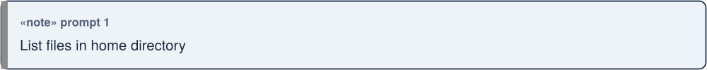

2. > you are in a sandbox

   No requirement — observation acknowledged.

   

3. > if you want to run any ssh git or bash command that does not work,
   > put it in claude.sh and write the output to claude.out

   Workflow instruction for this session (not a project requirement).

   

4. > You are going to be building software for me. All the dependencies
   > should be fulfulled using a flake. I dont like NPM, PyPi etc. use
   > them as a last resort

   **Requirement:** all dependencies sourced via a Nix flake; PyPI/npm
   only as a last resort.

   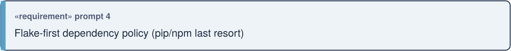

5. > Use a flake to provide me a project structure for getting a
   > workflow in place to publish data to postgresq (including rasters)
   > and working with qgis to view that data.
   >
   > (clarifying answers: location = this folder; language = Python;
   > Postgres = external server; data scope = vector + raster; project
   > name = geopublish; git = init + commit, no push; DB connection =
   > placeholder `.env.example` only)

   **Requirement:** scaffold the `geopublish` project — flake devShell,
   CLI skeleton, `publish vector`/`publish raster` commands, QGIS
   connection story.

   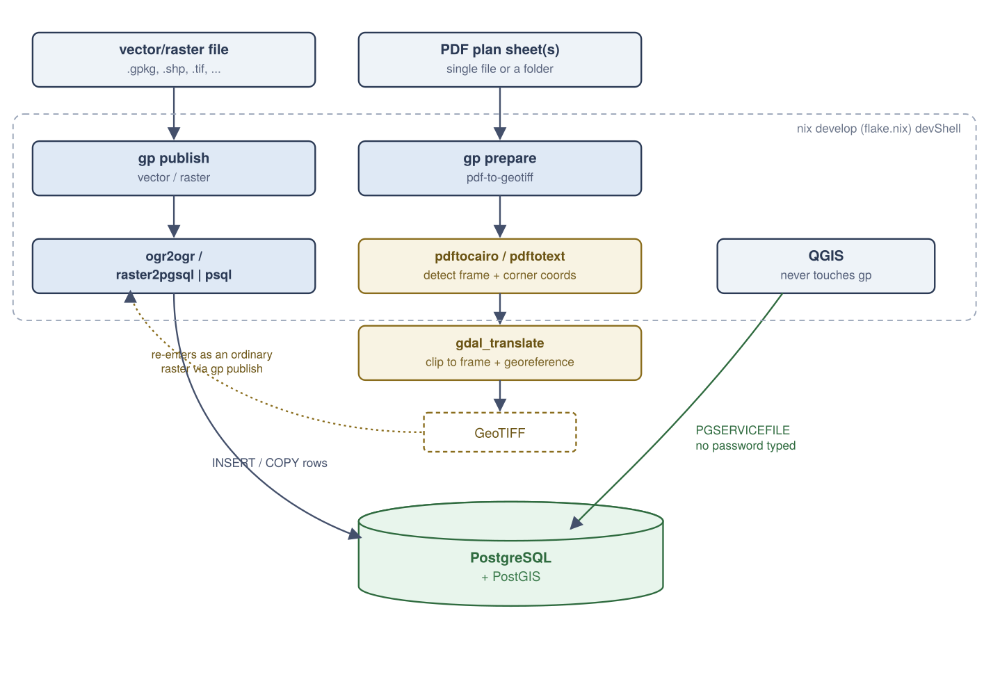

6. > I want to be able to look at the docs locally with a convenience
   > command like gp docs-serve.

   **Requirement:** `gp docs-serve` command.

   

7. > Also make sure the specification is included in the docs

   **Requirement:** publish `SPECIFICATION.md` as a page in the mkdocs
   site.

   

8. > how do I check using sql if my db has pg raster installed

   No project requirement — SQL query provided directly.

   

9. > make sure screenshots-gitignore is git ignored. look at the latest
   > screenshots

   **Requirement:** gitignore the screenshot folder (`screenshost-gitignore/`).

   

10. > first we need to check the connection works

    No new requirement — exercised the existing `gp status` command.

    

11. *(pasted traceback: missing `.env`/environment variables)*

    Surfaced a real gap, fixed directly (copied `.env.example` → `.env`).

    

12. *(pasted traceback: `UndefinedTable` — postgis/postgis_raster not
    installed)*

    **Requirement (bug):** `status`/`init-db` should fail with a clear
    message, not a raw traceback, when extensions aren't set up yet.

    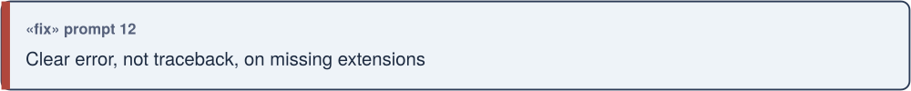

13. *(pasted traceback: `InsufficientPrivilege` creating `postgis_raster`)*

    **Requirement (bug):** `postgis` and `postgis_raster` must commit
    independently, so a managed server restricting the latter doesn't
    roll back the former.

    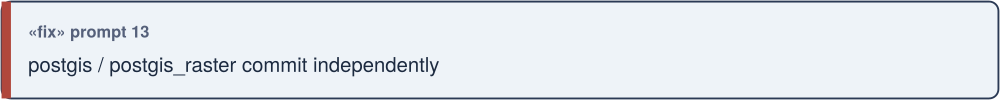

14. > the plans folder contains a pdf. I need you to build tools to clip
    > out the map and georeference it here in this app so that we can
    > upload it as a raster georeferenced tif to our dabase.

    **Requirement:** `gp prepare pdf-to-geotiff` — clip a PDF plan sheet
    to its map frame and georeference it to a GeoTIFF.

    

15. > Lets assume the coodinates in the top right and bottom left
    > corners are in UTM 32 N (germany). In the process make sure to
    > clip the diagram to just the map area. This tool needs to be
    > repeatable so that I can drop in a folder of plans and batch
    > convert them.

    **Requirement:** assume UTM32N/Germany by default; auto-detect the
    frame and corner coordinates (no manual pixel-picking); support
    batch conversion of a whole folder.

    

16. > how do I run it

    No new requirement — usage instructions given.

    

17. > I generated the two tiffs - can you check they are valid

    No new requirement — validated the output (binary GeoTIFF tag
    inspection, since no `gdalinfo` in this sandbox).

    

18. > ok now we want to publish then tiffs to the db

    No new requirement — used the existing `gp publish raster` command.

    

19. > make that command as a shell script I can run it is too much to
    > type

    **Requirement:** a convenience script (`PLANS/publish-netze-bw.sh`)
    bundling the two publish commands.

    

20. > its runninng how will I add the raster in qgis

    No new requirement — QGIS instructions given.

    

21. > that is really nice. Rasters are however slow to access in PG and
    > I see that the pdfs are vector based. Can you compute the
    > individual vertex coordinates based on our corner coordinates and
    > insert vector features into the db rather. All points into a
    > points table, all lines into "lines" and all polygons into
    > "polygons". Try your best to extract whatever annotations are
    > associated with each feature and attach them as attributes of the
    > geometries.

    **Requirement:** `gp publish pdf-vectors` — extract point/line/
    polygon geometry directly from a PDF's drawing commands into shared
    `points`/`lines`/`polygons` tables, with nearest-text-label
    annotation. (Design started here; implementation landed later, at
    prompt 42, after other work intervened.)

    

22. > I want you to create a new table in the db called 'collab'. There
    > should be one attribute 'name'. The CRS should be 3857. Also make
    > a .lyr file with the styling and forms etc. so that I can easily
    > share the layer.

    **Requirement:** `collab` table (`id`, `name`, `geom`), EPSG:3857,
    plus a shareable QGIS Layer Definition with styling and an edit
    form.

    

23. > I cant see the docs for these new things we added

    **Requirement (bug):** the pdf-to-geotiff/collab how-tos existed
    only in `README.md`, which `gp docs-serve` never reads — move them
    into the actual `docs/` site.

    

24. > how do I run the table creation for collab

    No new requirement — usage instructions given.

    

25. *(pasted error: `psql` aliased to `pgcli`, doesn't support `-f`)*

    **Requirement (bug):** document the `command psql` workaround and
    the `which -a psql` fallback.

    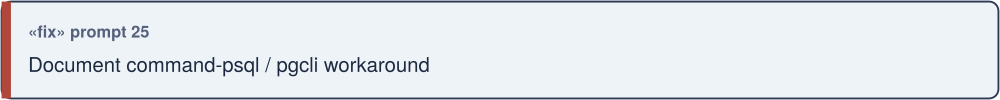

26. > that doesnt look very nice. for tables you should be using UML to
    > diagram the tables and also a nice table showing the attributes
    > etc. THe diagram should be made as an svg turned into png, not
    > done in mermaid (for all diagrams).

    **Requirement:** every table gets a UML class diagram + a Markdown
    attributes table; every diagram in the project is hand-authored SVG
    rendered to PNG, never Mermaid.

    

27. > how do I run the table creation for collab

    Repeat of 24 — reiterated the same instructions.

    

28. *(pasted: `which -a psql` output)*

    Confirmed the real `psql` binary's path.

    

29. > I dont like you running commands I have on my system - I want it
    > provisioned by the flake

    **Requirement:** every tool used to produce a committed deliverable
    must be provisioned by the project's own flake — never an ambient
    sandbox tool. (Added `inkscape` to the flake; retracted a PNG I'd
    rendered with the sandbox's own copy.)

    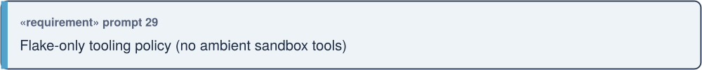

30. *(pasted the same `pgcli` error again)*

    Repeated 25's fix verbally.

    

31. > I cannot see the images in the user docs yet

    **Requirement (bug):** the diagram PNGs hadn't been rendered yet
    (`nix run .#diagrams` not yet run), and the diagrams lived on the
    Specification page, not the User guide — both clarified.

    

32. > the collab table needs to be editable by all users

    **Requirement:** grant `SELECT, INSERT, UPDATE, DELETE` on `collab`
    (and `USAGE, SELECT` on its sequence) to `PUBLIC`.

    

33. > Now that collab layer is great but I want a PG_NOTIFY message to
    > be sent every time the table has a crud event. You can see
    > examples of how to do that in the sql_1 folder. Take care to use
    > the correct message and topic etc.

    **Requirement:** `pg_notify('qgis', 'collab')` on every CRUD event
    (channel hardcoded by QGIS's provider; payload distinguishes the
    table), matching the pattern in `sql_1/0001_poi_notify.up.sql`.

    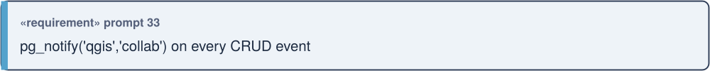

34. > I have a new requirement. I want to have the capital cities of the
    > world as a layer and then a script that runs and gets the
    > temperature for each city and updates the temperature column for
    > each city. Only use free no api key data sources so I dont have a
    > lot of hassles setting this up.

    **Requirement:** `gp capitals load` (Natural Earth, public domain)
    + `gp capitals refresh-weather` (Open-Meteo, free, no key).

    

35. > I want a view in the database that creates a dynamic dissolved
    > buffer around the collab points. The buffer should be 100km in
    > radius. It should also use pg notify if possible.

    **Requirement:** `collab_buffer_100km` view, geodesically-correct
    100km dissolved buffer, extending the same notify trigger with a
    second payload.

    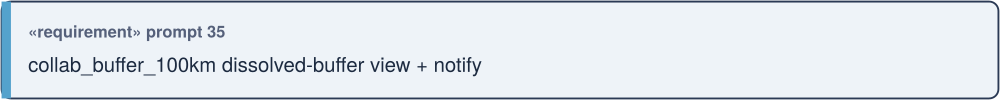

36. > I want to add to the docs a full transcript of all the prompts I
    > gave you and the resulting diagrams explaining each steop. Then
    > add a gp docs-pdf command that lets me generate a pdf of the
    > transcipt

    **Requirement:** this page, its diagrams, and `gp docs-pdf`
    (deferred at the time in favour of finishing in-flight work first;
    delivered -- with a diagram per prompt, not a single summary --
    after prompt 44 asked again).

    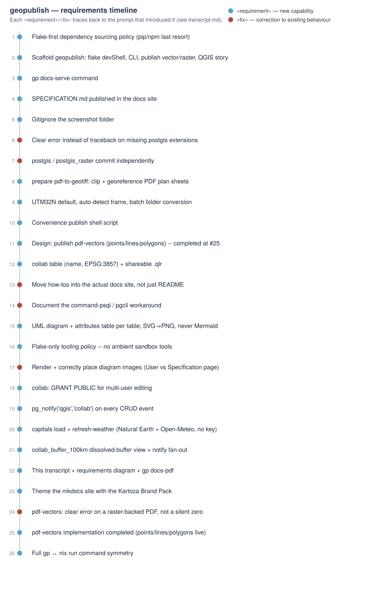

37. > how do I get my cities layer

    Surfaced that `capitals` hadn't actually been implemented yet
    (verified, then built).

    

38. > https://github.com/kartoza/InfrastructureMapper please use this to
    > theme the documentation consistently [with the other docs we
    > make]

    **Requirement:** theme the mkdocs site with the Kartoza Brand Pack
    (vendored from that repo), not a one-off palette.

    

39. *(same link pasted again — confirmed not a mistake)*

    Confirmed 38 was intentional; theming proceeded as already planned.

    

40. > no that was not a mistake - I was asking you to apply the theming
    > from infrastructuremapper to the docs in this project

    Confirmed 38/39 again; theming was already complete by this point.

    

41. *(pasted: `gp publish pdf-vectors` output — `0 points, 0 lines, 0
    polygons` on both pages)*

    **Requirement (bug):** diagnosed as a genuinely raster-backed PDF
    (basemap baked in as embedded images, not vector paths) — raise a
    clear error instead of a silent zero.

    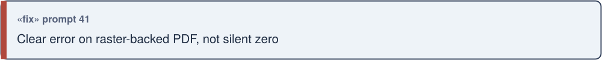

42. > lets get that pdf vector extraction sorted out next

    Resumed and completed 21's design: implemented
    `gp publish pdf-vectors`, `points`/`lines`/`polygons` tables, label
    matching, and tests.

    

43. > the gp commands are inconsistent with the nix run commands

    (Clarified via multiple-choice: every `gp` command needs its own
    `nix run .#name`.)

    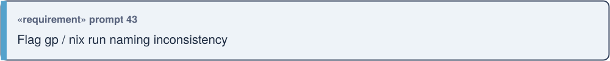

44. > can you include the full chat transcript and a diagram in uml
    > illustrating the requirement introduced by each prompt into the
    > mkdocs

    **Requirement:** this page and a diagram tracing requirements.
    First delivered as one consolidated timeline; corrected below (45a)
    to a diagram per prompt once that turned out not to be what was
    wanted.

    

45. > and every nix run command needs its own gp command

    **Requirement:** full bidirectional symmetry — `gp test`/`gp
    format`/`gp lint`/`gp diagrams` added to match the existing `nix run`
    dev-tool apps, and vice versa for every data/workflow command.

    

45a. > i dont see the uml diagrams in the transcript page. i want
     > literally every prompt to be explained with a diagram

     **Requirement (bug):** the overview diagram was linked, not
     embedded (genuine bug — fixed); and the one-diagram-per-*milestone*
     scoping from 44 was explicitly rejected in favour of one diagram
     per *prompt*, which is what this page now does throughout.
